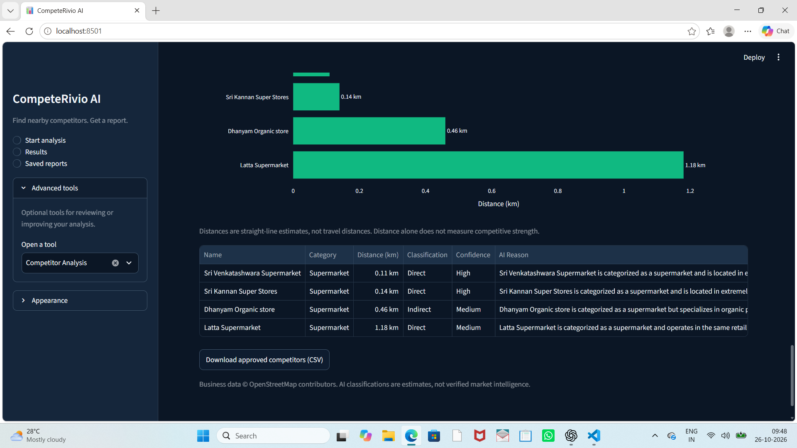

# CompeteRivio AI

A Streamlit dashboard that helps you find nearby businesses, review potential competitors, compare available evidence, and download a clear analysis report.

**Workflow:** Enter business details → confirm the profile → review competitors → approve the selection → explore the dashboard and download the report.

Built with **Python · Streamlit · OpenStreetMap · Google Gemini · Plotly**. The default workflow uses public map services and supports factual reports when Gemini is unavailable. Optional Google ratings require separate API configuration.

## Start here

1. On GitHub, select **Code → Download ZIP**, then extract the folder.
2. Install Python 3.11 or newer if needed.
3. On Windows, double-click **`start_dashboard.bat`**. First setup needs internet access and may take a few minutes.
4. Open **http://localhost:8501** and choose **New analysis**.
5. Try **DMart · Velachery, Chennai, Tamil Nadu, India · Supermarket · 3 km**. Check the returned branch before confirming. Live results depend on map coverage and service availability.

For Gemini features, add your own key to the generated local `.env` file and restart the dashboard. Never upload that file. Manual setup and optional integrations are explained below.

**Application entry point: `app.py`.** It opens the complete dashboard; `dashboard_preview.py` is also supported.

**Windows quick start:** double-click `start_dashboard.bat`. It creates a local environment if needed, installs missing dependencies, and starts the app. Python 3.11+ and internet access are needed for first setup. The dashboard starts with an overview; choose **New analysis** to begin.

## Run the project

Use Python 3.11 or newer. The current app was verified on Windows with Python 3.14 and Streamlit 1.62.0.

Download and extract the repository, or clone it, then open a terminal in the project folder.

### Windows PowerShell

```powershell
python -m venv .venv
.\.venv\Scripts\python.exe -m pip install -r requirements.txt
Copy-Item .env.example .env
.\.venv\Scripts\python.exe -m streamlit run app.py
```

### macOS / Linux

```bash
python3 -m venv .venv
.venv/bin/python -m pip install -r requirements.txt
cp .env.example .env
.venv/bin/python -m streamlit run app.py
```

Open **http://localhost:8501**.

For Gemini classification and AI suggestions, put your own key in the local `.env` file before starting:

```dotenv
GEMINI_API_KEY=your_own_key_here
```

The key is optional for a factual report from discovered data. Without a working key or available AI service, classification remains unavailable and reports use labelled standard validation steps. Internet access is required for live map discovery and website checks. Never commit a real API key.

## Optional Google ratings integration

The free workflow needs no Google Places key. To enable the separate live ratings panel, the person running the app can set this in their private `.env` file and restart Streamlit:

```dotenv
GOOGLE_PLACES_API_KEY=your_own_google_places_key
```

Enable **Places API (New)** and Google Cloud billing for that key. A Gemini subscription or Gemini API key does not provide Places access. Use a restricted server-side key; never upload it to GitHub.

After completing a search, open **Analysis tools → Evidence & Scores → Google ratings · optional live API**. Choose the request limit and click **Fetch live Google ratings (may incur charges)**. Each valid target makes one Text Search request, including rating fields that trigger Enterprise-tier billing; no pagination or automatic retry is performed. The panel defaults to five searches and allows at most sixteen per click. This is a request cap, not a monetary billing cap. Set Google Cloud quotas separately.

Only unique exact-name matches within 200 metres of the mapped business are accepted. Approximate own-business area centres are skipped. A wrong/ambiguous match, missing value, invalid key, disabled billing or API failure is shown explicitly. Check the returned branch address.

Google Maps results are kept only in temporary session state, separately attributed, and excluded from workspace persistence, report history, PDF/CSV/ZIP exports, AI prompts, scoring and the OpenStreetMap map. They clear on the next panel render after fifteen minutes or when the selected dataset changes. They do not auto-fill the manual evidence editor. No paid live request was made during implementation: integration is covered by mocked tests; real account verification must be done with the trainer's configured key.

Provider documentation: [Text Search](https://developers.google.com/maps/documentation/places/web-service/text-search), [Google Maps Platform terms](https://cloud.google.com/maps-platform/terms), [Places attribution and storage policies](https://developers.google.com/maps/documentation/places/web-service/policies), [Google privacy policy](https://policies.google.com/privacy). Names and coordinates are sent to Google only when the lookup button is clicked. Before any public deployment, publish app-specific Terms of Use and Privacy Policy covering the enabled integrations.

## Example search

| Field | Example |
|---|---|
| Business name | DMart |
| Location | Velachery, Chennai, Tamil Nadu, India |
| Industry | Supermarket |
| Search radius | 3 km |
| Website | Leave blank unless the correct branch website is known. |

1. In **New analysis**, enter details and click **Find business profile**.
2. Choose the correct shop/address, check its website, then click **Confirm profile and analyse**. Approximate area locations require explicit acknowledgement. No competitor search or AI classification runs before confirmation.
3. Review the candidate list. Use **Add or remove competitors** to look up another business or enter its actual coordinates. Known directory domains/patterns and duplicate listings are filtered. New entries remain unclassified. Local relevance combines category evidence and distance; Google search prominence is unavailable.
4. Click **Approve competitors and create report**. The app opens **Dashboard** with charts, the competitor list and a map. Download the PDF there, or use **New analysis** for the complete analysis ZIP. Selection changes invalidate the current report while preserving saved history.
5. Open **Saved reports** to access completed reports.

Optional review: **Analysis tools → Competitor Analysis → Classify Competitors with Gemini**, then review the rows and click **Approve Selected Competitors**. Regenerate the report after changing the selection.



The screenshot is an example from a previous run, not a guarantee of the next search's results. It shows three Direct and one Indirect AI estimate in a four-business selection.

## What works

- Business lookup and nearby discovery using OpenStreetMap services.
- Automatic classification of up to 15 candidates when Gemini is available.
- Profile confirmation before discovery, explicit competitor review before report creation, and manual competitor addition/removal.
- Searchable industry dropdowns on New analysis and Business & Discovery, with 78 common industry presets (including Training Academy, Digital Marketing Agency, Software Company, retail, health, education, hospitality and professional services). Type an unlisted industry and press Enter to retain your own label. Unmapped custom industries open manual competitor review without querying an unrelated map category; automatic discovery depends on an available mapping and local map coverage.
- Charts, map, sourced website observations, and manual evidence entry.
- Captured keyword overlap/gaps and estimated intent clusters (Branded, Service, Location, Informational, or Unclassified), with explanations, a per-business chart, filters and sourced CSV export. These are cue-based estimates from captured page terms, not actual search-query intent, volumes or rankings. Regenerate reports to include the current intent summary; archived reports retain their original content.
- Explicitly partial relative scores with adjustable weights.
- Factual report fallback when AI suggestions cannot be generated.
- PDF, Markdown, CSV, JSON, and complete-analysis ZIP downloads.
- Local persistence, saved report history, backup/restore, and saved-selection comparison.
- Native Light and Dark appearance: **top-right ⋮ menu → Theme**.
- With website checks enabled, accessible listed/supplied websites provide captured page terms. The app also attempts keyless Google PageSpeed mobile audits for up to two unique websites per run. Available Lighthouse scores appear in the website-audit comparison and regenerated PDF; service failures show a reason rather than invented scores. Google receives the audited URLs. Keyless quotas can be unavailable; Lighthouse JSON upload remains an optional fallback. Uploaded audits are stored separately and are not automatically included in the competitor PDF or strength score.

## Availability and interpretation

- A map-service fallback is limited and not an exhaustive competitor list.
- Unclassified businesses are not automatically treated as direct competitors. **Unavailable is not zero.**
- AI classifications and suggestions require user review.
- Distances are straight-line estimates. An area-centre fallback is labelled explicitly.
- Ratings, review counts, ad counts, and keyword counts are not automatically verified. Missing measurements stay unavailable.
- Scores use only supported categories with complete supplied evidence; the full seven-category strength model is not implemented.
- Captured webpage terms are not search volumes or Google rankings.
- Public services and Gemini can return temporary failures or quota errors. The default discovery flow uses free public map services. Google Places is an optional separate integration that can incur charges only after its fetch button is clicked; Gemini billing and quotas depend on the configured account.

## Automated checks

Run from the project folder with the environment's Python:

```powershell
.\.venv\Scripts\python.exe -m unittest discover -s tests -q
```

On macOS/Linux, use `.venv/bin/python` instead. Tests mock external services rather than requiring live requests or Gemini tokens. This does not independently verify business data or guarantee live API availability.

## Project structure

```text
app.py                  Application entry point
start_dashboard.bat     Windows setup and launch shortcut
dashboard_preview.py    Main dashboard implementation
dashboard/              User interface pages
services/               Discovery, AI, evidence, scoring, reports, persistence
tests/                  Automated service and UI checks
.streamlit/config.toml  Native Light/Dark themes
.env.example            Blank API-key configuration template
docs/                   Optional project notes and demonstration guide
```

Saved work is written to `.local/` on the machine running the app. A new checkout starts without personal saved reports. `.env`, `.local/`, virtual environments, and generated temporary outputs are excluded from Git.

## Hosting note

This repository is configured for a local, single-user review. A GitHub repository link displays the source code; it does not start the Streamlit application. A separate hosting setup is needed for a browser-only live link. Shared public hosting also needs user-isolated persistence: the current local workspace file must not be shared between unrelated users.
